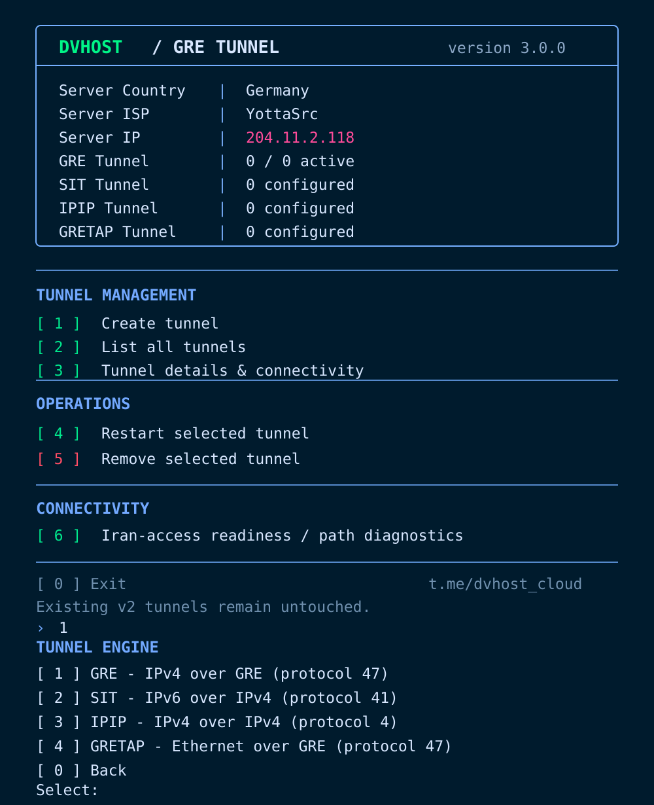

# DVHOST GRE Tunnel v3.0.0 (экспериментальная версия)

**🌐 Язык:** [English](README.md) | [فارسی](README.fa.md) | **Русский**



*Это иллюстрация интерфейса; данные сервера приведены только для примера.*

## О проекте
Версия 3 позволяет создавать **независимые GRE-туннели от одного сервера в Иране к нескольким зарубежным серверам**. Ветка находится в разработке; перед использованием в рабочей среде проверьте её на тестовом сервере. **Интерфейс и сообщения скрипта остаются на английском языке.**

## Устойчивость к ограничению международной связи

Пункт **6 — Iran-access readiness / path diagnostics** проверяет маршрут до внешних узлов, ICMP до внутренних и публичных адресов, DNS и внешний HTTPS. Проверка **не изменяет** туннели, маршруты или брандмауэр. Отсутствие ответа ICMP не всегда означает реальный сбой передачи данных.

Для повышения устойчивости используйте два и более зарубежных сервера у разных провайдеров и отдельный канал администрирования. Переключение прикладного трафика между туннелями требуется настраивать отдельно; **автоматического переключения здесь нет**. GRE не может восстановить связь при полном отсутствии доступных международных маршрутов.

## Выбор движка туннеля: GRE или SIT

Пункт **1 — Create tunnel** предлагает **GRE (IPv4 через GRE, IP-протокол 47)** или **SIT (IPv6 через IPv4, IP-протокол 41)**. Для SIT создаются независимые интерфейсы `sit01`, `sit02` и т.д. На иранской стороне предлагается случайный частный IPv6-префикс `/64`; на зарубежной стороне необходимо ввести **тот же префикс**. Создание, просмотр, перезапуск и удаление туннелей выполняются независимо.

Пример SIT: Иран `fd12:3456:789a:bcde::1/64` ↔ зарубежный сервер `fd12:3456:789a:bcde::2/64`. Разрешите **IP-протокол 41** (это не TCP/UDP-порт 41). SIT переносит только IPv6, не шифрует трафик и не гарантирует работу при фильтрации. Автоматическое переключение прикладного трафика между GRE и SIT не реализовано.

**Настройка SIT:** При создании предлагается MTU (обычно 1400), ограниченный MTU внешнего интерфейса/маршрута за вычетом 20 байт заголовка IPv4; допустимый диапазон 1280–1480. Локальный MTU не гарантирует такой же MTU на всём пути. В просмотр туннеля добавлена проверка минимального размера пакета IPv6; очистка systemd-сервиса при ошибке усилена. Изменения применяются при создании новых SIT-туннелей, старые службы не перезаписываются автоматически.

## Новые движки: IPIP и GRETAP

В меню добавлены **IPIP** (IPv4 поверх IPv4, IP-протокол 4) и **GRETAP** (Ethernet L2 поверх GRE, IP-протокол 47). Для каждого интерфейса создаётся отдельная служба systemd (`ipip01`, `gtap01`), без глобальных изменений Netplan. IPIP использует собственную частную IPv4-подсеть. **GRETAP создаёт только изолированный Ethernet-интерфейс** и намеренно не подключает его автоматически к мостам или VLAN, чтобы избежать петель L2 и потери доступа. При необходимости мост и маршрутизацию настройте отдельно. GRETAP не решает проблему блокировки GRE (протокол 47). Шифрования нет. Перед запуском проверьте синтаксис через `bash -n` и испытайте на тестовом сервере.

## Возможности
- Отдельный systemd-сервис для каждого туннеля (`dvhost-gre-v3-greXX.service`)
- Управление через `ip tunnel` **без глобального `netplan apply`**
- Отдельная частная сеть `/30` для каждого туннеля
- Проверка локального публичного IP, маршрута к удалённому серверу, имён и подсетей
- Откат изменений только нового туннеля при ошибке создания или настройки автозапуска
- Конфигурации туннелей версии 2 не изменяются

## Запуск
```bash
bash <(curl -fsSL https://raw.githubusercontent.com/dev-ir/gre-tunnel/v3.0.0/main.sh)
```

Требования: Linux, root, systemd, `iproute2` и `modprobe`. В сетевых экранах и сети провайдера необходимо разрешить **IP-протокол GRE (47)**.

### Пример: один сервер в Иране и два зарубежных
| Сервер | Пример интерфейса | Внутренний IP |
|---|---|---|
| Иран → зарубежный сервер 1 | `gre01` | `10.50.1.1/30` |
| Зарубежный сервер 1 → Иран | `gre01` | `10.50.1.2/30` |
| Иран → зарубежный сервер 2 | `gre02` | `10.50.2.1/30` |
| Зарубежный сервер 2 → Иран | `gre01` | `10.50.2.2/30` |

На обоих концах одного туннеля используйте **одну и ту же подсеть** и соответствующие роли Iran/Foreign. Имена интерфейсов на разных серверах могут отличаться.

## Текущие ограничения
- Новые туннели запускаются отдельными systemd-сервисами после готовности сети; Netplan ими не управляет.
- Автоматического переноса туннелей v2 нет; их конфигурация сохраняется.
- Существующие маршруты и сторонние сетевые инструменты могут вызывать конфликты.
- Страна и ISP определяются через внешний сервис с кэшированием до 24 часов; информация может быть недоступна. IP в заголовке определяется по локальному маршруту.
- Расширенный мониторинг, журнал отключений и интеллектуальное восстановление ещё не реализованы полностью.
- **GRE не шифрует трафик.** При необходимости используйте дополнительную защиту.
- Убедитесь, что путь `/usr/bin/ip` существует в вашей системе.
- Версия ещё не проверена на рабочих серверах.

**Telegram:** https://t.me/dvhost_cloud
